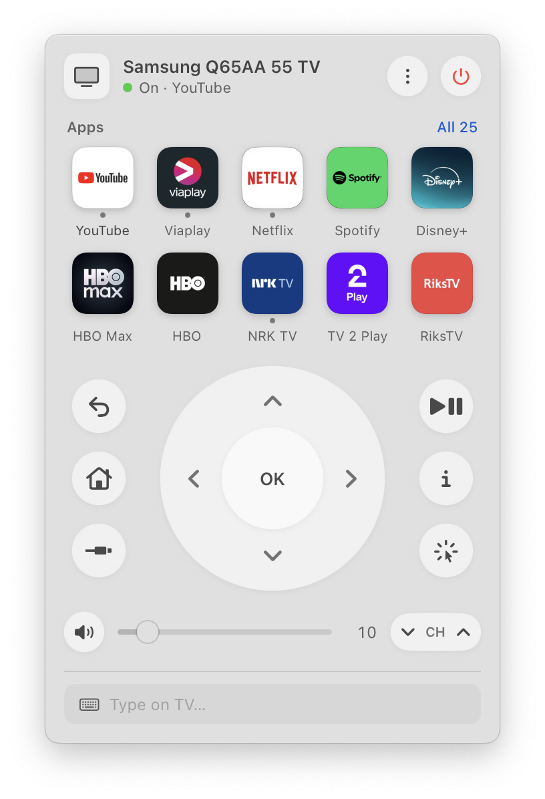

# Couch Remote

Menu bar remote for the Samsung Q65AA TV. Built on [TVKit](Sources/TVKit), a self-contained Swift library for Samsung Tizen TVs that lives in this package.

<p align="center">
  <picture>
    <source media="(prefers-color-scheme: dark)" srcset="docs/screenshot-dark.png">
    
  </picture>
</p>

```
scripts/build-app.sh            # → build/Couch Remote.app and build/tvctl
scripts/build-app.sh --install  # also copies the app to ~/Applications
open "build/Couch Remote.app"
```

Needs Xcode 26 (Swift 6.2) to build and macOS 14 or later to run. On macOS 26 the controls use Liquid Glass; earlier systems get the same shapes in translucent material.

## Using it

Click the TV icon in the menu bar, or press **⌃⌥T** anywhere to open the remote as a floating window (Esc hides it). Opening the app again from Spotlight or Finder does the same. Useful on a MacBook with a full menu bar, where macOS hides overflowing icons behind the notch.

- **Apps:** click to open. Drag to rearrange; the first ten show when the list is collapsed. Right-click to move to front or end, or hide.
- **Remote:** D-pad, OK, Back, Home, Source (the TV's input list), Play/Pause, Info, volume slider (reads the TV's real volume), channel up/down. Hold the arrows, OK or Back to repeat, like the physical remote.
- **Trackpad:** the cursor button swaps the D-pad for a pad that steers the TV's pointer (browser and pointer-aware apps). Click the pad to take over; your Mac cursor freezes, movement goes to the TV and clicks click there. Esc gives it back.
- **Keyboard** (while the popover is open): arrows steer (hold to repeat), Return is OK, Delete is Back, Space plays or pauses, H is Home, I is Info, M mutes, + and − change volume, 0–9 send number keys.
- **Type on TV:** open a search field on the TV, type in the field at the bottom and press Return.
- **Remote buttons** (Settings): make the Netflix, Prime Video or Samsung TV Plus button open another app. Couch Remote must be running; the original app shows for about a second before the switch.

## Development

- `--window` opens the remote window at launch; add `--light` or `--dark` to force an appearance (used for the README screenshots).
- `design/layout.html` is the layout mockup.
