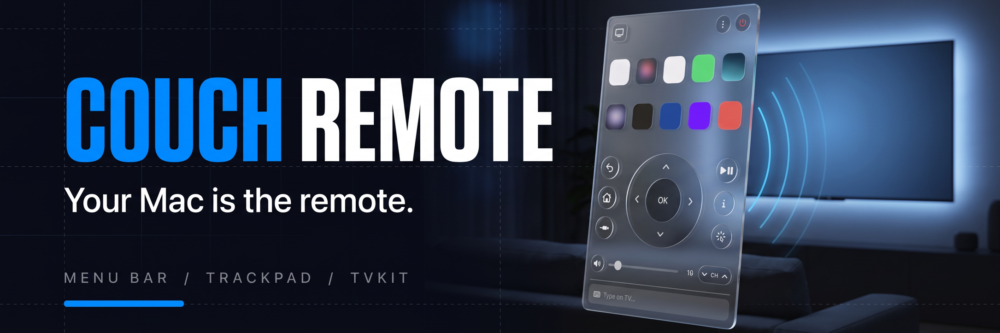

# Couch Remote

[](https://github.com/HelgeSverre/couch-remote/actions/workflows/tests.yml)
[](Package.swift)
[](Package.swift)
[](docs/PROTOCOL.md)
[](LICENSE)

A remote for Samsung smart TVs that lives in your Mac's menu bar. Open apps, steer with the
arrow keys, set the volume, drive the TV browser's cursor with your trackpad and type into
its search fields, all over your local network.

Built on [TVKit](Sources/TVKit), a dependency-free Swift library for Samsung Tizen TVs that
ships in this package, and `tvctl`, its command-line twin.

[Install](#install) · [Using it](#using-it) · [tvctl](#tvctl) · [TVKit](#tvkit) ·
[Compatibility](#compatibility) · [Protocol notes](docs/PROTOCOL.md)

<p align="center">
  <picture>
    <source media="(prefers-color-scheme: dark)" srcset="docs/assets/screenshot-dark.png">
    
  </picture>
</p>

## Features

- **Apps:** your TV's apps with their real icons. Click to open, drag to rearrange, hide the ones you never use.
- **Remote:** D-pad, OK, Back, Home, Source, Play/Pause, Info and channels. Holding a button repeats it, like the physical remote.
- **Volume:** a slider that reads and sets the TV's actual volume.
- **Keyboard:** arrow keys, Return and Delete work the D-pad while the remote is open.
- **Trackpad:** steer the cursor in the TV's web browser, click, and type straight into the field you clicked.
- **Remote button rules:** make an app button on the TV remote open something else, such as Prime Video → YouTube.
- **Power:** turns the TV off, and on again from standby.

## Install

Couch Remote is built from source. You need macOS 14 or later and Xcode 26 (Swift 6.2).

```sh
git clone https://github.com/HelgeSverre/couch-remote.git
cd couch-remote
scripts/build-app.sh --install
open ~/Applications/"Couch Remote.app"
```

`scripts/build-app.sh` builds `build/Couch Remote.app` and `build/tvctl`; `--install` also
copies the app to `~/Applications`, which **Open at login** needs.

The first time it runs, Couch Remote finds your TV on the network and asks to pair. Press
**Allow** on the TV when the prompt appears. macOS may also ask to let Couch Remote find
devices on your local network.

## Using it

Click the TV icon in the menu bar, or press **⌃⌥T** anywhere to open the remote as a
floating window; Esc hides it. Opening the app again from Spotlight or Finder does the same.
That helps on a MacBook with a full menu bar, where macOS hides icons behind the notch.

| Key | Does |
|---|---|
| ← ↑ → ↓ | D-pad (hold to repeat) |
| Return | OK |
| Delete | Back |
| Space | Play / Pause |
| H · I | Home · Info |
| M | Mute |
| + · − | Volume |
| 0–9 | Number keys |

**Apps.** Click "All" to see every app. Drag tiles to set the order; the first ten are the
ones shown when the list is collapsed. Right-click a tile to move it to the front or end, or
hide it.

**Trackpad.** The cursor button (bottom right of the remote) swaps the D-pad for a pad.
Click the pad and your Mac cursor freezes: movement now moves the TV's cursor, clicks click
on the TV, and typing goes into the field you clicked. Delete erases, Return confirms, Esc
gives your cursor back.

**Typing.** The field at the bottom types into whatever text field is focused on the TV,
live as you type. Return confirms.

**Remote button rules.** In Settings → Remote Buttons, add a rule like "When Prime Video →
YouTube". When Prime Video opens, Couch Remote opens YouTube instead. Couch Remote has to be
running, and the first app shows for about a second before the switch.

## tvctl

`tvctl` uses the same settings and pairing as the app.

```sh
swift run tvctl discover               # find TVs and remember the first
swift run tvctl info                   # model, power state, developer mode
swift run tvctl pair                   # press Allow on the TV
swift run tvctl key VOLUP VOLUP HOME
swift run tvctl hold RIGHT 1.5         # hold a key for 1.5 s
swift run tvctl apps
swift run tvctl launch netflix
swift run tvctl volume 12
swift run tvctl remap "Prime Video" YouTube
swift run tvctl sdb apps               # Developer Mode only: exact app list with use counts
```

Run `swift run tvctl` for the full list.

## TVKit

TVKit is a library product of this package with no dependencies, so another app can use it
and it can move to its own package later.

```swift
import TVKit

let tv = SamsungTV(host: "192.168.10.57", token: savedToken)
try await tv.connect(allowPairing: true)    // first time: press Allow on the TV
tv.press(.home)
tv.hold(.right); tv.release(.right)
try await tv.launch(appID: "111299001912")  // YouTube
try await tv.setVolume(12)
```

See [Sources/TVKit/README.md](Sources/TVKit/README.md) for the API and
[docs/PROTOCOL.md](docs/PROTOCOL.md) for the protocols underneath: the REST API, the
remote-control WebSocket, UPnP, Wake-on-LAN and sdb.

## Compatibility

Tested on a Samsung **QE55Q65AAUXXC** (2021, Tizen 6.0). Samsung Tizen TVs from 2016 on
should mostly work, but model years differ in small ways; TVKit handles the differences
documented by other projects. Pre-2016 TVs, which aren't Tizen, are not supported.

If something doesn't work on your TV,
[open a compatibility report](https://github.com/HelgeSverre/couch-remote/issues/new?template=tv-compatibility.yml)
with your model and the output of `tvctl info`.

## Development

```sh
swift build
swift test
scripts/build-app.sh
```

- `--window` opens the remote window at launch and `--settings` the Settings form; add
  `--light` or `--dark` to force an appearance. The README screenshots use these.
- `TVKIT_DEBUG=1` prints every WebSocket message from the TV, for example with `tvctl raw`.
- App icons live in `Sources/TVKit/Resources/AppIcons`. Icons for installed apps are the
  TV's own Smart Hub tiles; `scripts/fetch-icons.sh` downloads App Store icons for the rest.
- On macOS 26 the controls use Liquid Glass; earlier systems get the same shapes in
  translucent material.

## License

[MIT](LICENSE). App names and icons are trademarks of their owners. Couch Remote isn't
affiliated with Samsung.
